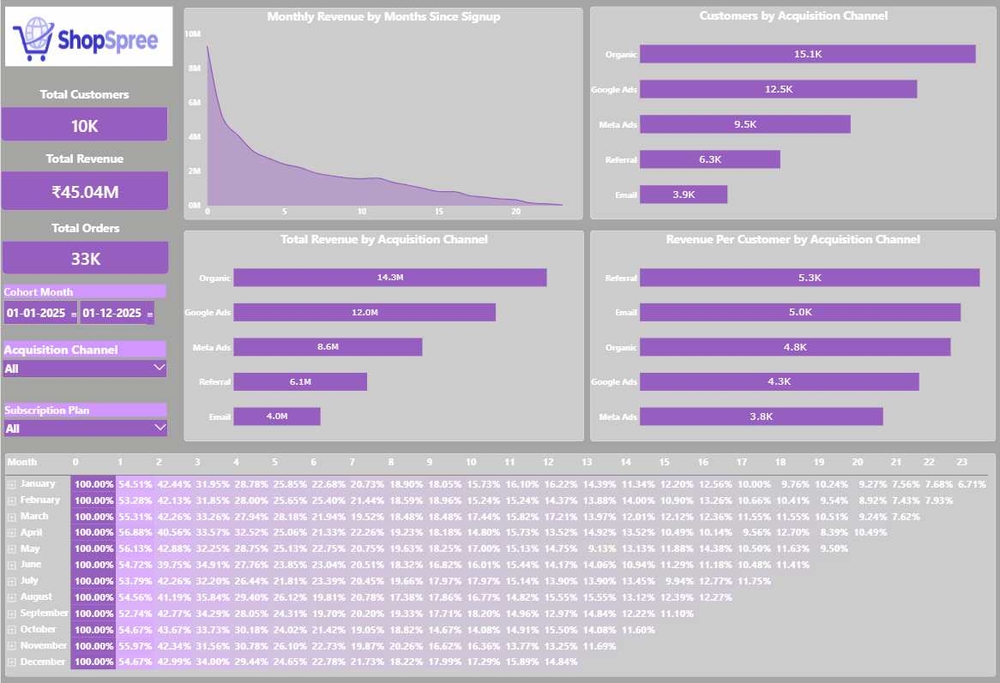

# ShopSpree – E-Commerce Cohort Analysis Dashboard

An e-commerce cohort analysis project using **SQL, Power BI, and Excel** to analyze customer retention, cohort performance, and repeat purchasing behavior.

## 📊 Dashboard Preview



## 📌 Project Overview

This project analyzes customer purchasing behavior for **ShopSpree**, an e-commerce business, using cohort analysis. The objective is to understand how customer retention changes over time, identify purchasing patterns, and generate actionable insights that can support data-driven business decisions.

The project uses **SQL** for data preparation and cohort analysis and **Power BI** for interactive data visualization and reporting.

## 🎯 Business Objectives

- Analyze customer retention across different acquisition cohorts.
- Understand how customer purchasing behavior changes over time.
- Identify high-performing and low-performing customer cohorts.
- Evaluate repeat purchasing behavior and customer engagement.
- Present key metrics through an interactive Power BI dashboard.
- Generate insights to support customer retention strategies.

## 🛠️ Tools & Technologies

| Tool | Purpose |
|---|---|
| **SQL** | Data preparation, transformation, aggregation, and cohort analysis |
| **Power BI** | Dashboard development and data visualization |
| **Excel** | Supporting data analysis and validation, where applicable |
| **CSV** | Dataset storage and data import |
| **GitHub** | Project documentation and version control |

## 📂 Project Structure

```text
ShopSpree-Cohort-Analysis/
│
├── README.md
├── cohort_Analysis_synthetic_dataset.csv
├── ShopSphere_Cohort_Analysis.sql
├── ShopSphere_Cohort_Analysis_Dashboard.png
└── Cohort_Analysis_Dashboard.pbix
```

## 📈 Key Analysis Areas

### 1. Customer Cohort Identification

Customers are grouped into cohorts based on their first purchase or initial activity period, according to the dataset and the analysis definition.

### 2. Customer Retention Analysis

Customer activity is tracked across subsequent periods to measure retention and compare behavior between cohorts.

### 3. Repeat Purchase Behavior

The analysis examines repeat purchasing patterns to understand whether customers return to make additional purchases after their initial transaction.

### 4. Cohort Comparison

Different customer cohorts are compared to identify variations in customer engagement and retention over time.

### 5. Dashboard Visualization

The Power BI dashboard presents cohort metrics and retention patterns through visualizations that make trends easier to understand.

## 🧮 Methodology

1. **Data Import:** Import the e-commerce dataset from CSV into the SQL environment.
2. **Data Validation:** Check data types, missing values, duplicate records, and date consistency.
3. **Data Preparation:** Prepare and validate customer and transaction data for analysis.
4. **Cohort Assignment:** Identify each customer's cohort using the selected first-activity date.
5. **Retention Calculation:** Track customer activity across periods relative to the cohort's starting period.
6. **SQL Analysis:** Aggregate cohort metrics and prepare the results for reporting.
7. **Power BI Dashboard:** Visualize cohort performance and retention metrics using appropriate charts, tables, and KPIs.
8. **Business Interpretation:** Interpret the analysis to identify patterns and potential business actions.

## 📊 Key Performance Indicators (KPIs)

## 📊 Key Performance Indicators (KPIs)

The Power BI dashboard highlights the following key performance indicators to summarize customer behavior, revenue performance, and purchasing activity.

- **Total Customers:** 10K
- **Total Revenue:** ₹45.04M
- **Total Orders:** 33K
  
### Retention Rate Formula

\[
\text{Retention Rate (\%)} =
\frac{\text{Customers Active in a Later Period}}
{\text{Customers in the Original Cohort}}
\times 100
\]

*Note: Metric definitions depend on the dataset structure and the calculations implemented in the SQL queries and Power BI dashboard.*

## 💡 Business Value

Cohort analysis helps an e-commerce business move beyond aggregate sales figures to understand how customer behavior evolves over time.

The findings can support decisions related to:

- Customer retention and re-engagement campaigns.
- Repeat purchase and customer loyalty initiatives.
- Customer experience improvements.
- Identification of cohorts with stronger long-term engagement.
- Marketing optimization and customer lifecycle strategies.

## 🚀 How to Explore the Project

1. Clone or download this repository.
2. Open `cohort_Analysis_synthetic_dataset.csv` to review the dataset.
3. Explore `ShopSphere_Cohort_Analysis.sql` to review the SQL analysis.
4. Open `Cohort_Analysis_Dashboard.pibx` in Power BI Desktop, after correcting the file extension if necessary.
5. View `ShopSphere_Cohort_Analysis_Dashboard.png` for a preview of the dashboard.

## 📁 Project Deliverables

- **Dataset:** Synthetic e-commerce customer and transaction data.
- **SQL Script:** Queries for data preparation and cohort analysis.
- **Power BI Dashboard:** Visual representation of cohort performance and retention metrics.
- **Dashboard Preview:** Image of the Power BI report.
- **Documentation:** Project objectives, methodology, KPIs, and analytical approach.

## 👩‍💻 Author

**Sneha**

Aspiring Data Analyst | SQL | Power BI | Excel | Data Visualization

---

*This project was developed for analytical learning and portfolio demonstration. The dataset is synthetic, and the findings should be interpreted in the context of the dataset and the implemented analysis.*
